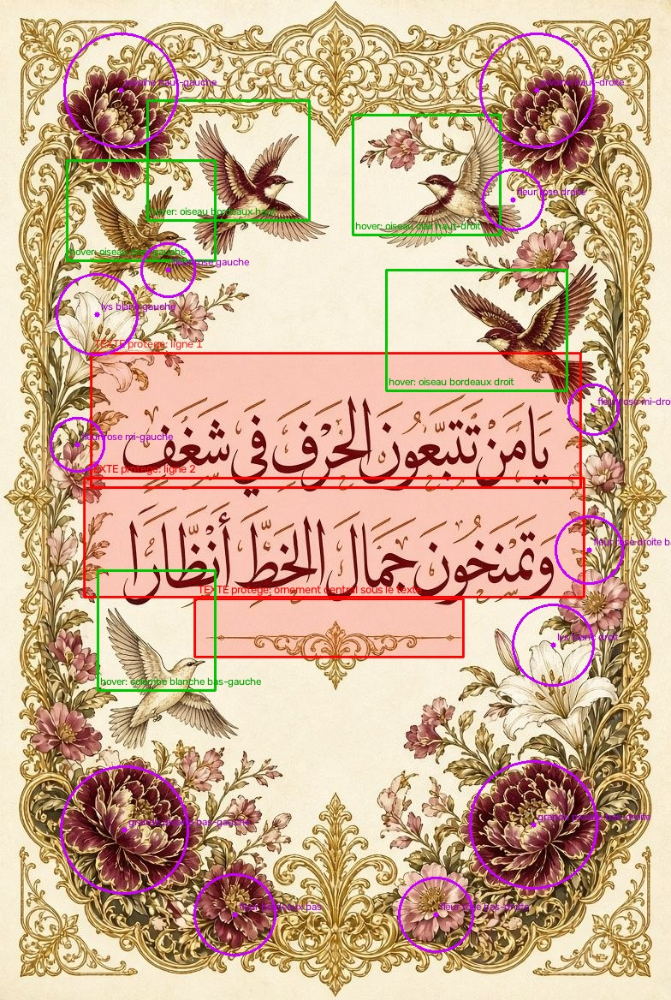

# 🎞️ animate_calligraphy.py — Animer oiseaux & fleurs sans toucher au texte

Script **Python ≥ 3.10** qui donne vie aux affiches de calligraphie arabe :
les **oiseaux** battent des ailes et dérivent en vol stationnaire, les
**fleurs** se balancent au vent et « respirent », les **dorures** scintillent,
des **pétales** dérivent dans les bordures — tandis que le **texte reste
strictement intact, au bit près**.



## 🎯 Le principe : le « sanctuaire de texte »

1. Chaque ligne de calligraphie est déclarée dans un fichier JSON
   (rectangle en coordonnées normalisées 0..1) — voir `configs/`.
2. Ces rectangles forment un **masque de protection dont le cœur vaut
   exactement 1.0**. La toute dernière opération du pipeline réinjecte les
   pixels **originaux** dans ce cœur, à chaque image.
3. Tous les effets sont en outre atténués à zéro dans une **zone tampon**
   autour du texte : rien ne « fuit » sur les lettres, et un oiseau proche
   du texte passe visuellement *derrière* le plan de la calligraphie.

Résultat prouvable (commande `verify`) : **écart maximum dans le texte = 0**
sur toutes les images échantillonnées. Protection *ligne par ligne* : sur
l'affiche `01`, le colibri situé **entre** le titre et la première ligne
vole librement sans qu'aucune lettre ne bouge.

> ⚠️ **Précision honnête sur les formats** : la garantie « bit à bit » vaut
> pour les images générées par le moteur. Un MP4 (compression H.264 avec
> pertes) modifiera forcément les valeurs de pixels à l'encodage — mais le
> texte n'y est jamais ni déplacé, ni déformé, ni animé. Pour un livrable
> strictement sans perte, utilisez `--png-dir` (séquence PNG).

## ⚙️ Installation

```bash
python -m venv .venv
# Windows : .venv\Scripts\activate   |   Linux/macOS : source .venv/bin/activate
pip install -r requirements.txt
```

Dépendances : `numpy`, `opencv-python-headless`, `Pillow`, `imageio`,
`imageio-ffmpeg` (fournit FFmpeg/libx264 pour des MP4 propres).

## 🚀 Utilisation

```bash
# 1) Rendre UNE affiche (MP4 + GIF dans output/), avec preuve d'intégrité
python animate_calligraphy.py render images/03_creme_bordeaux.jpg \
    --config configs/03_creme_bordeaux.json --verify

# 2) Rendre les 4 affiches d'un coup
python animate_calligraphy.py batch --configs configs --output-dir output --verify

# 3) Vérifier les zones avant de rendre (rouge = texte, vert = oiseaux, magenta = fleurs)
python animate_calligraphy.py preview images/01_colibri_papillons.jpg \
    --config configs/01_colibri_papillons.json

# 4) Vérifier l'intégrité du texte sans produire de vidéo
python animate_calligraphy.py verify images/04_vert_emeraude.jpg \
    --config configs/04_vert_emeraude.json

# 5) Nouvelle affiche : générer un modèle de configuration à ajuster
python animate_calligraphy.py init-config ma_nouvelle_affiche.jpg
```

### Options principales (`render` et `batch`)

| Option | Défaut | Rôle |
|---|---|---|
| `--duration` | 6 | durée d'une boucle (secondes) — la boucle est **parfaite** |
| `--fps` | 30 | images par seconde |
| `--width` | native | largeur de sortie (0 = résolution d'origine) |
| `--intensity` | 1.0 | amplitude globale (0.5 = très subtil, 1.5 = marqué) |
| `--bird-engine` | `warp` | `warp` : déformation locale sans halo · `sprite` : détourage GrabCut, plus grandes amplitudes |
| `--birds/--no-birds`, `--flowers/--no-flowers`, `--shimmer/--no-shimmer`, `--petals/--no-petals` | activés | activer/couper chaque effet |
| `--png-dir DOSSIER` | — | séquence PNG **sans perte** (texte garanti bit à bit de bout en bout) |
| `--verify` | — | prouve après rendu que le texte est intact |

## 🗂️ Format de configuration (JSON)

Toutes les coordonnées sont **normalisées** : `0.0` = haut/gauche, `1.0` = bas/droite.

```jsonc
{
  "name": "Mon affiche",
  "image": "../images/mon_affiche.jpg",          // relatif au fichier JSON
  "text_zones": [                                 // ← LE SANCTUAIRE (obligatoire)
    { "rect": [0.145, 0.360, 0.710, 0.120], "label": "ligne 1" }   // [x, y, largeur, hauteur]
  ],
  "birds": [
    { "bbox": [0.100, 0.160, 0.220, 0.100], "mode": "hover",       // hover | perched | butterfly
      "label": "oiseau doré", "phase": 0.0,
      "amplitude_px": 8, "flutter": 0.055, "flutter_cycles": 12 }
  ],
  "flowers": [
    { "center": [0.180, 0.090], "radius": 0.085,                   // rayon relatif à la largeur
      "label": "pivoine", "phase": 0.0, "sway_px": 5.0, "breathe": 0.018 }
  ],
  "effects": {
    "bird_engine": "warp", "wind_px": 2.2, "petal_count": 14,
    "petal_colors": ["#e8a7bf", "#d97b9c", "#f2c9d4"],
    "protect_margin_px": 8, "protect_feather_px": 16, "seed": 42
  }
}
```

**Modes d'oiseaux** : `hover` = en vol (dérive + battement rapide) ·
`perched` = posé sur une branche (simple respiration, ~1 px) ·
`butterfly` = les ailes se referment horizontalement vers le corps.

**Ajouter une nouvelle affiche** : `init-config` → ouvrir l'image et le JSON
côte à côte → ajuster les rectangles → `preview` pour contrôler visuellement
→ `render --verify`. Astuce : la boîte d'un oiseau doit contenir **tout**
l'oiseau (bout des ailes et de la queue compris), avec quelques pixels de marge.

## 🔬 Comment ça marche (pipeline par image)

1. **Plaque de fond** — moteur `warp` : l'image originale ; moteur `sprite` :
   oiseaux détourés (GrabCut, alpha interdit sur le texte) et fond reconstruit
   par inpainting Telea.
2. **Champ de vent** (un seul `cv2.remap`, calculé en basse résolution ×0.25) :
   brise globale pondérée par saturation + proximité des bordures, gaussienne
   de balancement + pulsation radiale par fleur, et en mode `warp` gaussienne
   elliptique par oiseau (translation + battement anisotrope + rotation).
   Le champ est **multiplié par la porte anti-texte** : nul près des lettres.
3. **Scintillement des dorures** — masque HSV des pixels dorés × vague de
   lumière diagonale voyageante.
4. **Sprites** (moteur `sprite` seulement) recomposés en alpha.
5. **Pétales** — particules confinées aux bordures, fondu sinusoïdal,
   extinction automatique à l'approche du texte.
6. **Restauration du sanctuaire** — toujours en dernier :
   `image = animée·(1−α) + originale·α`, avec `α = 1` dans le cœur du texte,
   puis réassignation dure des pixels du cœur. **C'est la garantie.**

Toutes les fonctions du temps utilisent un nombre **entier** de cycles par
boucle (`sin(2π(c·t + φ))`, `c ∈ ℤ`) : la première et la dernière image se
raccordent parfaitement, idéal pour les fonds d'écran et les réseaux sociaux.

## ✅ Tests

```bash
python tests/test_text_protection.py     # 5 tests, sans dépendance à pytest
pytest tests/ -q                          # …ou via pytest si installé
```

Les tests vérifient sur image synthétique : texte bit-identique, bouclage,
mouvement réel des ornements, aller-retour JSON, rejet des configs invalides.

## 📦 Contenu du dossier

```
calligraphy_animator/
├── animate_calligraphy.py     # le script (point d'entrée unique)
├── requirements.txt
├── images/                    # les 4 affiches source
│   ├── 01_colibri_papillons.jpg      (أسعد الله صباحكم — colibri & papillons)
│   ├── 02_sauge_or.jpg               (fond sauge, lettres d'or)
│   ├── 03_creme_bordeaux.jpg         (يا من تتبعون الحرف في شغف)
│   └── 04_vert_emeraude.jpg          (4 vers, fond vert émeraude)
├── configs/                   # zones mesurées affiche par affiche (JSON)
├── tests/test_text_protection.py
└── output/                    # rendus de démonstration (régénérables)
    ├── *_anime.mp4 / *_anime.gif     # boucles de 6 s, texte vérifié intact
    └── *_zones.jpg                   # aperçus annotés des zones
```

## 🩺 Dépannage

- **« imageio-ffmpeg indisponible »** → `pip install imageio-ffmpeg`, sinon le
  script bascule automatiquement sur l'encodeur OpenCV `mp4v`.
- **Un oiseau semble « déchiré » près du texte** → sa boîte chevauche une zone
  protégée : réduisez sa `bbox` ou son `amplitude_px` (le fondu de protection
  amortit le mouvement à l'approche des lettres, c'est voulu).
- **Halo autour d'un oiseau (moteur sprite)** → passez en `--bird-engine warp` :
  sans détourage, il n'y a ni halo ni couture.
- **Rendu lent** → baissez `--fps` (25) ou `--width` (p. ex. 600) ; le champ de
  vent est déjà calculé au quart de résolution.

---

*Conçu pour les affiches de calligraphie du dépôt Tomato_Articles — que les
oiseaux volent et que les fleurs dansent, mais que jamais une lettre ne tremble.*
